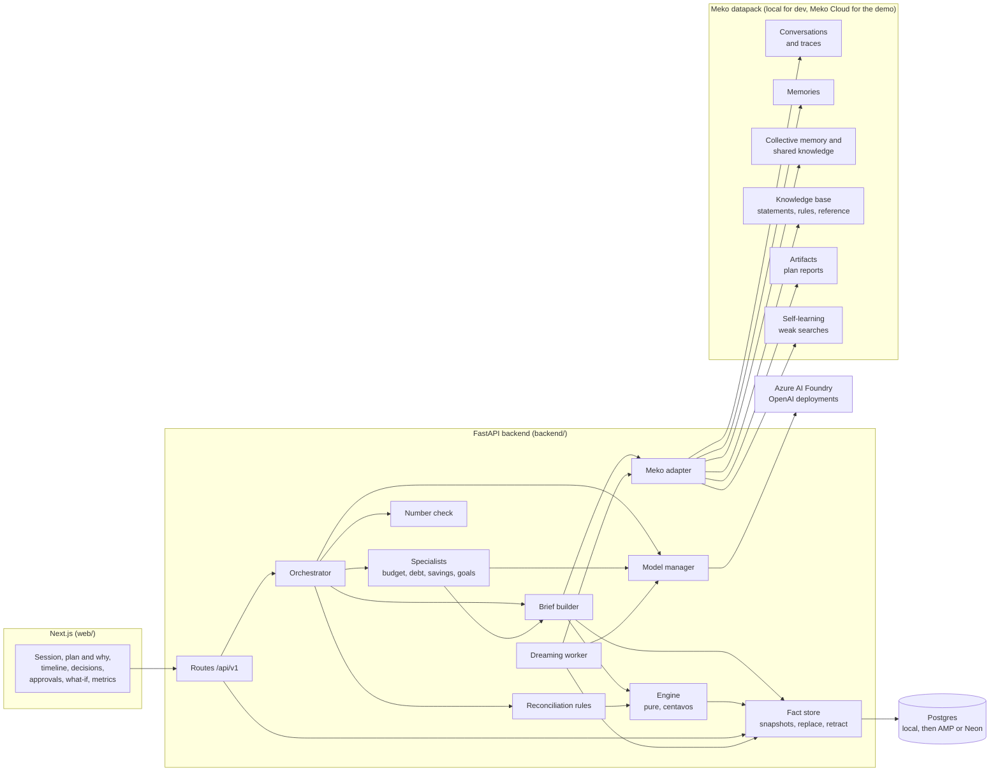

# Architecture

How Kako is built: the parts, how one planning turn and one life event flow through them, how Kako uses
each part of Meko, the controls that keep numbers and memory honest, where it runs and what it costs.
**Code follows this document.** If code and this document disagree, raise it, and update this document
in the same change once agreed.

Tables and formulas are in [data-model.md](data-model.md). The order of work is in
[build-plan.md](build-plan.md). Meko facts here were checked on Nov 17, 2026 against local Meko
1.20261116.0 (its MCP tools, by calling them) and Meko's agent skills plugin v2.6.1 (its tool
references); limits change, so check again before relying on one.

## In one paragraph

Kako is a **Next.js** web app in front of a **FastAPI** backend. The household talks to Kako in
planning sessions; each session is a **Meko conversation**, so every turn and every Meko call is traced.
The household's structured data lives in **Postgres** as facts with a validity window and a replacement
chain, and a **deterministic engine** computes every peso, month and date from a snapshot of those
facts. An **orchestrator** agent answers each turn by calling four **specialists** (budget, debt,
savings, goals) as tools; they read the engine's figures and a context brief built from Meko's memory,
knowledge base and past conversations, and propose moves. Code checks the proposals against the surplus
and against each other; the orchestrator tries other splits through the engine and resolves conflicts in
the open, every agent step is logged for the screen, and a **number check** blocks any figure the engine
did not produce. Models are **Azure AI Foundry** deployments, reached only through the model manager. After each session a **dreaming** job reviews the conversation and the
memories Meko extracted from it, reconciles what it heard with what is known, marks what has been replaced, spots patterns, and puts
proposals in front of the household. Approved facts become Meko memories; approved preferences and
decisions can be promoted to the datapack's **shared knowledge**, where every specialist finds them.

## Diagram

## How one planning turn flows

1. **The household writes** in the session screen. The API appends the turn to the session's Meko
   conversation when the answer is ready (step 8), with a stable seed so a retry stores it once.
2. **Snapshot and figures.** The fact store builds the snapshot for the household's date. If its hash
   differs from the last calculation run, the engine computes a new run; otherwise the last run is
   reused. The engine is pure: same snapshot in, same figures out.
3. **The brief.** Code builds a context brief within a size budget (about 3,000 tokens): the key
   figures, the active decisions with their reasons, approved preferences and constraints, pending
   proposals, the household's last 5 life events, in a replan what changed (see "How a life event
   replans"), and the results of **one** `context_search` on the household's message (memories, shared
   knowledge and documents, past conversations). A turn as known at a time (demo mode, the test set)
   sees the decisions, proposals and life events as Kako knew them then. Specialists start from this brief instead of searching
   on their own, which keeps the answer grounded and the Meko call count low. Agents see stable refs, never
   database ids (`debt:credit-card`, `figure:debt.payoff_months@debt:credit-card`, `M1` for a
   memory), so a recorded turn replays anywhere. Approved preferences come from the fact store, with
   who approved them and when, and are marked promoted once Meko holds them as collective memory.
   Over budget, code drops what agents can fetch again: Meko results (lowest ranked first), the
   rejected options of decisions, older pending proposals, then the facts list.
4. **The orchestrator** reads the brief and calls the specialists it needs as tools, in parallel. It can
   also propose a fact or a life event the household just stated (see the next section).
5. **Each specialist** is a short, bounded loop (at most 4 tool calls) over read-only tools:
   `get_figures`, `get_facts`, `get_decisions`, `search_memory` (one extra Meko search at most) and
   `run_what_if` (the engine with hypothetical allocations). It returns a structured proposal: the
   allocation it wants (an entity and an amount), its recommendation text, and the sources it cites.
   **Amounts are specs, never numbers a model worked out:** `none`, `rest` (the rest of the surplus,
   subtracted in code), `figure:<ref>`, `fact:<ref>`, or `said:<amount>`, an amount the household wrote
   in this turn's message, which code finds there. A proposal rests on one of the specialist's own
   what-ifs, so its allocations are ones the engine has run; code refuses a what-if over the surplus or
   outside the specialist's area, and a proposal that cites no figure of its what-if or no other source
   (V-11). The orchestrator's options are checked the same way: each is one what-if of the turn, cited.
   What-ifs are named after the agent that ran them (`debt1-W1`), and a specialist sees only its own
   what-ifs and searches (the orchestrator sees all of them), so parallel specialists send the same
   requests on every run and a recorded turn replays. A final tool runs only on its own in a reply, so
   an answer rests on results the agent has read. An empty reply (no words, no tool call; seen once on
   Foundry) is sent back once with only the final tool offered.
   Every tool call by every agent is logged as an `agent_step` (the agent, the tool, a short input and
   result, the what-if run if any), which the "agents' steps" view shows.
6. **Reconciliation in code.** Once two or more specialists propose a move, the engine runs once more
   with all their allocations together (each entity takes its own specialist's amount: the debt
   specialist's for a debt, savings' for an account, goals' for a goal). Rules
   (`planning/reconcile.py`) find over-allocation (together the asks leave less than ₱0 of the
   surplus), opposite moves (one raises an allocation another lowers), and goals that miss their date.
   The asks together become a what-if of the turn (`rec-W1`), and code tells the orchestrator what it
   found, with the figures, in a note between its rounds of tool calls. **The what-if loop:** while a
   conflict is open, each `run_what_if` the orchestrator makes is a split, at most 3 a turn; only the
   reconciliation rules can say a split fits, and each split is an `agent_step` (`rejected` when the
   rules refuse it). The answer then carries the resolution: a split that fits, offered as an option
   and recommended, with the what-if it rejected and why; or, when nothing (a preference, a decision,
   the household's own words) supports one split or no split fits, the choice left to the household,
   which sees the conflict and the options, not a guess. The resolution, each split tried and the
   option rejected are shown, and stored in `reconciliation` with the plan.
7. **The number check.** Every number in the reply, the options' labels and summaries, the resolution's
   reason and each specialist's summary must match a figure of the turn's run or one of its what-ifs,
   a fact in the snapshot, a what-if's allocation, or a number the household wrote (rule V-10,
   `agents/numbers.py`). A specialist's summary may also name the turn's own refs, which the
   orchestrator resolves from the proposal's citations; the reply, the options and the reason may
   not. It runs inside the final tools (`submit_answer`, `submit_proposal`): a
   failure is sent back once with the mismatch named; if it fails again, the text is shown with the
   unmatched numbers flagged, never silently. Every check is a `number_check` row, against the turn's
   run, which is stored before the agents start.
8. **Recorded.** The agents' tools write nothing: each what-if runs in memory, and is kept with the
   turn as a `scenario`, its `plan.allocation` overrides and its run, which the `agent_step` that ran
   it then names (a turn that fails leaves no scenario). A turn that offers options or finds a conflict proposes a
   plan (`db/plan_store.py`, one transaction): the reply is its summary, each option's allocations are
   its recommendations with the option's sources (a figure of the run that showed it, and a fact,
   decision, memory, document or the household's words), and each conflict is a `reconciliation` row.
   Each final number check names the row it checked. The reply goes to the household with a "why" link
   on each recommendation. The turn goes to Meko with a `plan` (the steps taken: the brief, the
   specialists asked, the reconciliation, the options) and `reasoning` (the specialists' summaries and
   the resolution's reason), built by code from what the agents handed in, and metadata naming the
   plan, run, recommendation, reconciliation and what-if run ids, the prompt versions the turn ran with (and any numbers the check flagged), so the Meko trace and Kako's own
   sources say the same thing. The session's Meko calls are its trace: spans in Meko Cloud's Observe
   hub, or local Meko's call log (`GET /api/v1/sessions/{id}/trace`). The plan is `proposed` until the
   household accepts one option; accepting writes its `plan.allocation` facts (Phase 4).

## How a life event replans

This is the centre of the live demo.

1. Mara says she has a new job from Dec 1 at ₱68,000 take-home. The orchestrator calls
   `propose_change` once: the `new_job` life event and the facts it changes (here Mara's salary), each
   value copied from her words, with the words as `quote`. Code checks it before holding it
   (`agents/proposing.py`): the quote is in her message, every number is in the quote (V-09), the
   entity and attribute exist, and a change replaces the fact Kako holds now and starts after it; a
   value Kako already holds, a life event it already has, or `plan.allocation` (chosen by accepting a
   plan) is refused. The turn keeps what it holds as **pending proposals** with her words as evidence
   and her as the speaker, a life event with its facts in one transaction, and the answer says what
   waits for a yes. Nothing changes until then. (Dreaming finds the same thing after the session, under
   the same idempotency key, and reports it as already proposed: never twice.)
2. The household approves (`/api/v1/proposals/approve`, `kako proposals approve`). The fact store
   inserts the new fact, closes the old one (`valid_to` = Dec 1, `status` = `replaced`, `replaced_by` =
   the new one) and records the life event. (Rewriting the old memory in Meko in the past tense comes
   with Meko upkeep, Phase 4, task 5.)
3. The session's next turn is a **replan** (`agents/replan_store.py`): code finds the changes approved
   from this session's turns, as known at the turn, and takes the turn as of the latest day one of them
   takes effect (Dec 1). It recomputes the run the household last decided on, from the facts as Kako
   knew them when it decided (the latest decision: in the demo, Session 3's of Oct 18; with no
   decision, the session before its changes), and F-DIFF-1 gives what changed between the two runs,
   the facts behind it, and the **decisions whose assumptions** included a replaced or retracted fact
   ("to revisit": in the demo, all three of Sessions 1 to 3, in the order they were made, never by
   id, so a recording replays on any database). Both runs are stored, so each figure in the diff
   traces.
4. The brief has a replan section with the figures before and now, the facts behind them and the
   decisions to revisit, all by ref; code tells the orchestrator which specialists' figures moved, and
   it asks them to reassess, with the decisions to revisit and the preferences in the brief. The
   number check also knows the figures and facts the household last decided on, so "₱9,050 before" is
   a number it can match.
5. Kako answers in three parts: **the new plan** (the reply and its options); **what changed**, written
   by code from the diff (each figure that moved, old and new, by its meaning); and **why**: the
   orchestrator's `why`, number-checked like any text and required in a replan, then the facts behind
   the change (each labelled replaced, retracted, new or allocation) and the decisions to revisit with
   the session they came from, written by code. The turn kept in Meko carries all three parts, the run
   it was compared with, the decision it was compared against and the decisions to revisit
   (`kako_replan_*` metadata). The session API returns them as `replan` and the pending changes as
   `changes`.

Session 4 (`data/demo-household/sessions/session-4.toml`) shows it on the demo household: Mara's news,
her approval at 8 PM on Nov 20 (which writes changes.csv rows 10 and 11, checked against the story),
and Jun's question answered as the replan.

## How dreaming works

A background job queued when a session ends (`dream_run`, one per session, so a rerun does nothing).
Ending a session (`POST /api/v1/sessions/{id}/end`, or `kako dream end`) refuses any more turns and
queues the run; `kako dream run` runs what is queued, one at a time. The code is `kako/dreaming/`.

1. **Read** the session's turns from Meko (`conversation_get`, as the orchestrator, the agent that
   created the conversation: Meko answers no other). Only the turns Kako kept for this session count:
   each carries its seed, the session's id, the household's date and who said it (`kako_said_by`) in
   its metadata. Then the household's facts and life events as known at the run, with the life events
   still waiting for a yes. Then the memories Meko extracted from those turns on its own: one
   `memory_search` limited to the conversation (`run_id`), with the household's words as the query.
   Those without Kako's `kako_` metadata are **candidates**, shown to extraction as noted memories
   (`m1`, in Meko's words, wrapped in `<data>`). They are what Meko counts as Learnings, memories
   waiting to be kept or promoted, so dreaming reads Learnings session by session (`dreaming/candidates.py`).
2. **Extract** candidate claims with the model, as structured output: one call to one tool,
   `submit_claims`, with the turn, the quote, a life event if any, and each fact's entity, attribute,
   value **as quoted** and the day it takes effect, whether the household said a value Kako holds
   was wrong, and the noted memories that say the same as the claim. A noted memory is never a quote. The model copies; it does not calculate. It reads only the household's words (Kako's
   replies hold engine figures, which are not theirs), wrapped in `<data>` blocks, with the entities
   by their refs, the attributes, and what Kako holds on the session's date. A wrong shape goes back to
   it once; nothing else does (`dreaming/extract.py`, prompt `agents/prompts/dreaming.md`).
3. **Check in code** (`dreaming/classify.py`, pure). The turn is the session's and the quote is in it,
   word for word; the entity and attribute fit; every number in a candidate appears in its quote
   (V-09). A claim that fails is **refused**, with why. Then each fact is compared with what Kako holds
   on the day it takes effect: **same** (dropped), **new**, **replace** (a later value for the same
   thing), **retract** (the household said a value was wrong: the retraction, and the right value from
   the same day as a new fact, its date quoted from the fact it replaces) or **conflict** (two values
   for the same day, or one older than a value Kako has; nothing is proposed, and the run lists it to
   ask). Within one session the same value said twice is proposed once, two values for one day are a
   conflict, and a second change to the same thing waits for the first (**deferred**).
4. **Patterns.** Code counts the household's decisions by the tags of the option they chose (such as
   `favours_flexibility`, from a fixed list in `decision_option.tags`; the orchestrator tags options when
   it proposes them, and code rejects a tag that is not on the list). Three choices the same way across at least two sessions, with none the other
   way, produce a `preference_pattern` proposal, citing each decision in the household's words and
   naming each session (`dreaming/patterns.py`, pure; `dreaming/promotion.py`). A pattern the household
   already holds proposes nothing; the same decisions never propose it again, even after a no; and
   nothing is proposed while another proposal for the same preference waits. A session with no Meko
   conversation (a decision of the demo's story) is dreamed over for this step and the next alone.
5. **Promotion candidates.** A preference approved from a pattern (its decisions already span two
   sessions), and an active decision once two sessions have ended after it without revising it, are
   proposed for promotion, once ever (a no is final), with the plain warning that promotion can't be
   undone. The same runs right after each approval, so a preference approved between sessions is offered
   at once. Approving one needs a second confirmation. A preference goes to **collective memory** (its
   sentence, which every agent retrieves). A decision goes to the **knowledge base** as a decision
   record: the question, the option chosen, the options rejected with their reasons, and what it rests
   on. Meko upkeep carries both out (step 8).
6. **Propose.** Everything lands in the approvals inbox with an explanation and its evidence: the quote,
   the turn it was said in (`<conversation id>:<seed>`) and who said it, with the run's id. A claim's
   proposals are stored together (a life event with its facts, a retraction with the value that takes
   its place). The idempotency key is the turn's, as in the session, so a change the session already
   proposed from the same words is **already** and never proposed twice. A noted memory a claim names
   is shown with its proposals (`extracted_memory` evidence, never counted as a quote for V-09). Nothing becomes household
   knowledge until a person says yes; a fact approved from dreaming's proposal says so (`source_kind`
   `dreaming`). The run keeps what it found in `dream_run.counts`.
7. **Settle the candidates** (`dreaming/memories.py`, after each run and with `kako dream settle`).
   Each noted memory has one fate, kept in `dream_run.counts`: **waiting** on the proposals its claim
   made now, each showing its words, or **delete** (no claim names it; its claim was refused, a
   conflict or deferred; it holds a number its claim's quote doesn't; or its claim made nothing new,
   so no person would see its words). A waiting memory is linked in `meko_link` to what was written
   only once a person has approved every one of those proposals, and deleted once any is turned
   down: the brief marks a linked memory approved, so its words must be what the household saw. A memory is deleted as the agent that wrote it, the only one Meko allows. So every
   extracted memory ends linked to an approved fact or deleted (V-14, checked by `kako dream check`,
   which also finds a memory Meko extracted after the run).
8. **On approval**, the fact store writes the rows; Meko upkeep (`kako/upkeep/`) then adds Kako's
   own memory of each new fact, rewrites a replaced one in the past tense (and deletes Meko's own
   words about it), and deletes a retracted one's memories, each as the agent that wrote it. It
   compares each fact's sentence with what it last wrote (`meko_link.text`), so it does only what
   is owed, and what it can't do now (Meko unreachable, its step bound) waits for the next run or
   `kako meko sync`; an approval never fails because of it. It also shares what was approved for
   sharing (`upkeep/promote.py`): it adds the preference's sentence and promotes it, after checking
   Meko's promoted memories so a stopped run never promotes twice, or uploads the decision record
   (`upkeep/records.py`), and links each in `meko_link`. Then, if a Context Gap answered by what
   was approved now has its memory, its search is replayed (`kako/gaps/`, Meko Cloud only).

Dreaming is a fixed workflow with one model step (extraction); the orchestrator and specialists are the
agentic part. The docs and the video say so.

Dreaming is tested against a labelled set (`data/dreaming/labelled.toml`, `kako dream eval`): scripted
sessions on the demo household with the proposals a person would expect, scored in code for what it
found, missed and wrongly proposed, and for any number not in its quote. It passes at 90% found with
none unquoted. A careful extraction scores every case exactly (`tests/test_evals_dreaming.py`), so a
real run's misses are the model's.

## How Kako uses each part of Meko

| Meko part | Kako's use | Where it shows |
| --- | --- | --- |
| Conversations | One per planning session, turns stored with `plan` and `reasoning` | Session history; dreaming's input |
| Decision traces | The conversation id is the trace id; every Meko call in the session is a span under it | "Open the trace on Meko Cloud" for each turn, on the plan screen and in "Show the working" (Meko Cloud's Observe for the demo) |
| Memory | One sentence per approved fact, decision and preference, with Kako's ids in its metadata; replaced facts rewritten in the past tense. Sentences name people and things in full ("Mara Villanueva's take-home pay…"), because Meko's search boosts named entities. Meko's own extracted memories are candidates for dreaming | Specialists' context; the timeline |
| Learning (promotion) | Dreaming reads Meko's Learnings and extracted memories, proposes, the household approves; a preference is promoted to collective memory, a decision record to shared knowledge | "Learned by dreaming from Session 3, approved by Mara on Oct 20, 2026" and "Shared with every agent in Meko" on the fact in the plan screen's why |
| Knowledge base | Synthetic statements (CSV), planning rules and Philippine reference documents (Markdown) | Cited excerpts in the why panel |
| Artifacts | Each plan report | Download on the plan screen |
| Postgres in the datapack (AMP) | The household's structured data, if the Phase 1 test passes; a scenario kept as an AMP branch (Should) | Architecture slide; what-if screen |
| Self-learning (Context Gaps) | Built (Phase 4, task 6), on Meko Cloud only (local Meko has no self-learning tools). `selflearning_query_log` lists `context_search` queries that came back Mid or Low (best score under 0.75); Kako keeps each shortfall of coverage as a `context_gap` with a question written by code; an adult ties the proposal that answers it (one that writes a fact); once that is approved and upkeep has written its memory, `selflearning_verify` replays the search, and the outcome and the score after are kept. Kako's brief uses `context_search`, which is the only search the log counts. Each replay counts as one search, so it goes through the call counter, at most 5 a run | "Kako would like to know" card (Phase 5); before and after scores on the metrics page |
| Metrics | Built (Phase 5, task 4). `datapack_metrics` (context size, how much `context_search` saves sending, relevance high, mid and low) read live by `GET /api/v1/metrics/meko`, in a conversation of its own made once per process; the tool takes no agent id. Shown next to Kako's own figures: each turn's tokens and cost, its brief against the whole context, and the number check | The metrics page |

What Meko does not do, and Kako adds (see [concept.md](concept.md#what-meko-already-does-and-what-kako-adds)):
Meko keeps both "₱100,000" and "₱120,000" as memories and returns both (tested); Kako decides which is
current, what it replaced and which plans and decisions depended on it.

## The session screen

The household plans in one screen shaped like the chat apps they already use, so there is nothing
new to learn about where things are:

- **Down the left**, the sessions, newest first, with their date and turn count, and "New session".
  The footer names the household and links the system check. The header holds Kako's mark and
  wordmark, the theme switch and, as in ChatGPT, a button that collapses the sidebar to a rail of
  icons (the mark, which opens it again, "New session", the screens, then System check,
  Documentation and the theme switch at the foot). The
  choice is kept on this device (`kako-sidebar`) and set before the first paint, like the theme. On
  a phone it is a drawer, and the same button closes it.
- **A new session** opens empty, as chat apps do: a greeting over the swirl art, the composer and a
  few starter questions any household could ask. The first message starts the session (its title is
  that message) and is sent as its first turn.
- **The conversation**: each person's message on the right with who wrote it, then Kako's answer:
  the reply, any flagged figures, the options with the monthly amounts and their sources, the
  replan (what changed, old struck through, why, the decisions to revisit), how a conflict between
  specialists was resolved, the approval card, and "Show the working", closed by default like a chat
  app's "thinking".
- **Before and after each option** (Phase 5a, item 5): each option's card says what it changes
  against today's plan ("Before → after": each debt paid off, the interest on every debt and the
  emergency fund at its target, today's value struck through, then the option's, with the change as
  a chip: emerald when it is better for the household, rose with its words when worse, plain when
  the same). Under the options, "Compare the options" sets today's plan and every option side by
  side, and each card's "See month by month" opens that option's months: each debt's amortization
  table with today's plan's balance beside every month and the month a paid-off debt's payment
  rolls in marked, and the emergency fund climbing to its target. Every value and change is the
  engine's (docs/data-model.md, "Before and after an option", C-1 to C-3), read from
  `GET /plans/{id}/compare`; an older turn whose snapshot can't be taken again says so plainly.
- **Approval cards inline.** A change the household stated waits on a gold card with the value it
  replaces struck through, who said it and their words. Approve or reject acts as the adult chosen
  in the composer; a child can't. Once decided it turns emerald ("Current") or rose ("Rejected").
- **The agents' steps** ("Show the working"): every tool call in order, a specialist's steps nested
  under the orchestrator's ask, each what-if split, what was sent back or refused and why, what each
  specialist proposed, and the turn's model calls, tokens, cost and Meko trace. While a turn runs,
  the steps appear as they are logged.
- **A long turn outlasts its connection.** A turn on live models can run a minute or more. The web
  app's pass-through to the backend waits up to 5 minutes (`experimental.proxyTimeout` in
  `next.config.ts`; Next.js gives up after 30 seconds by default and answers 500). If the request
  still ends with no answer (the connection dropped, or something between answered 500 or 504),
  the screen reads the session again before it says the turn failed: a turn kept since it was
  sent, with the same words, is shown as answered, one still running is waited for, and only then
  is the error shown (`web/src/lib/turns.ts`). "Try again" never sends a turn that was kept.
- **The composer**: Enter sends, Shift+Enter starts a new line, "Writing as" picks Mara, Jun or Lia,
  and "Synthetic data. Not financial advice." sits under it on every screen.

Each turn is kept as the household saw it (`session_turn`, the answer exactly as the API returned
it), written by the same code path for the API, `kako ask` and demo mode, so every turn shows on
the screen whatever ran it. The screen reads `GET /sessions/{id}/turns` (the kept turns with their
steps, and the running turn's steps so far) and polls it only while a turn runs. Every screen has
loading, empty and error states, with a way to try again. The look follows the tokens in
[look-and-feel.md](look-and-feel.md): dark by default with a light theme, one meaning per colour.

## The plan screen

`/plans` opens the household's newest plan and `/plans/{id}` any version, with a picker for the
others. "Plan" in the sidebar leads there, and every answer that made a plan links to it ("Plan v2:
why, down to the facts, and the number check"). It answers "why this advice?" and "why is this
different from before?" from the rows, never from a model:

- **The top bar**: the version, its status (gold "Proposed", emerald "Current" once a decision
  accepts it, muted "Replaced"), the household date it plans from, and the version picker.
- **The plan**: the session that proposed it (linked) and who asked, then Kako's reply as the
  household read it.
- **What changed** (orange edge), against the household's previous plan version or, for the first
  plan, the decision the household last made, with that run recomputed as Kako knew it then
  (F-DIFF-1): the figures that moved, the headline ones first and the rest under "more", the old
  value struck through; the facts behind them, each labelled (replaced, corrected, new, ended, the
  plan's amount) with the day it took effect; and the decisions to revisit with the facts they
  rested on. With nothing earlier to compare, it says so.
- **Each option**: its monthly amounts, the same "Before → after" as the session screen and its
  specialists, then "Why", open on the recommended option.
  The figures it cites, each with its value, the option's what-if amounts and "How it's worked
  out": the formula in words with its id from [data-model.md](data-model.md#calculations), the
  figures it was built from (each openable the same way) and the facts it read. The facts it cites,
  each with where it came from and who approved it ("From a statement, approved by Jun on Nov 16,
  2026", "Learned by dreaming from Session 3, approved by Mara on Oct 20, 2026"), the value it
  replaced struck through, and a violet chip once it is shared with every agent in Meko. The
  decisions it rests on with the options not chosen; what Meko gave (memories and knowledge-base
  excerpts, violet) and the fact each is kept for; the household's own words. And the number check:
  each number in the option's texts and what it matched, or that it matched nothing and was
  flagged. The check proves each number is one the engine, a fact, the option's amount or the
  household's words produced, not that the sentence uses it rightly, and the screen says so.
- **Compare the options and month by month**: under the options, as on the session screen.
- **How Kako weighed the specialists**: a reconciliation's conflict, the splits tried and the
  option rejected.
- **The turn that proposed it**: who asked and their words, the turn's Meko calls (tool, agent,
  results, milliseconds) and the link to its trace in Meko Cloud's Observe hub when it ran there.
  On local Meko it says the turn was kept in Meko; with Meko off, that it was kept only in Kako.
  "Show the working in the session" opens the agents' steps.

The words are written by code (`planning/why.py`: formulas, names, the number check's matches,
what changed) from the rows `db/plan_read.py` reads, only the household's. The screen has loading,
empty ("No plan yet"), error (try again) and missing ("No such plan") states. It shows a plan's
status and never changes it: accepting a plan is a decision the household approves. Plan reports
(Meko artifacts) are not built yet.

## The timeline and decisions screens

The storyboard's "The household" scene: the Villanuevas, their three past sessions, the old salary
closed and replaced, and the September decision with the option they turned down. Both screens are
in the sidebar under "Plan", read the household's rows only, and show them as Kako holds them;
nothing on them is changed from here.

`/timeline` opens with its title at the top left and its two views as chips under it, "What
happened" and "Each thing" (Pim, Nov 25, after Claude's Artifacts and Scheduled tasks pages). Each
view shows one line or one card per item first; an item's details open in a sheet (from the right,
or from the bottom on a phone; Escape, the close button or a click outside closes it).

- **What happened**, newest first, by month, one line each: an icon for its kind, a headline ("Mara
  got a new job") and under it the day, the kind, and who approved it or decided ("Dec 1, 2026 ·
  New job · Approved by Mara"), with "To revisit" or "Coming" beside it when it applies. Opened, an
  event shows everything about it, each on the day it took effect: Kako's start with the household's
  figures; each life event (orange) with the facts it changed, the old value struck through; each
  batch of new or replaced facts (a statement's three balances are one event, so are the plan's
  amounts a month, what was told in a session and what dreaming learned, violet once shared in
  Meko); each correction (rose) with what was wrong, what is back and why; each decision with what
  it chose and, gold, "To revisit" when a fact it rests on has changed since; each plan version and
  each session with turns, linked. Within a day the life event comes first and its facts are not
  listed again. An event after the household's date sits apart, "Ahead of the household's date":
  told on Nov 20, Mara's new job is approved and true from Dec 1.
- **Each thing**: cards, grouped by kind (the household itself, then every income, expense, debt,
  account and goal), each with its name, what it holds now (its first value: a salary's pay, a
  debt's balance), when it last changed, and "Changes Dec 1, 2026" or "Corrected" when they apply.
  Opened, a thing shows each attribute's values newest first, each with its window ("Mar 1, 2026 until Dec 1, 2026", the
  second day the first it no longer holds), where it came from and who approved it, when it was
  shared in Meko, and its state on the household's date: current (emerald), coming (orange), past,
  or corrected (rose, struck through, with the reason).

`/decisions` is a bookshelf (Pim, Nov 25): every decision a book, newest first, under the title
and four chips (All, To revisit, In force, Revised, each with its count; Revised takes in reversed
ones). A cover carries the question, who decided as its author ("by Jun"), the session and day, its
standing when it is no longer in force, and a gold ribbon when it is to be revisited; its colour and
pattern stand for the session it was made in and mean nothing else. Under the shelf, a pattern
across it is counted in code from each chosen option's tags ("All 3 of 3 decisions chose the option
that keeps cash on hand, never the one that pays debt off faster"), shown only when two or more
share one. Opening a book (`/decisions?book=<id>`, a link the timeline uses too) shows its cover
beside its page, with three bookmarks on one row as tabs:

- **The decision**: what was chosen (no option letter), what it leans to, the reasoning when the
  household's own words don't already say it, and their words; under "What was turned down", each
  option not chosen, greyed, with what it leans to and why not. Its standing, the decision that
  replaced it and the plan it accepted are linked when they apply.
- **To revisit** (`&mark=revisit`): each fact it rests on that has changed since, before struck
  through and after, from when; or that nothing has. A decision still in force uses everything Kako
  knows now, so a new salary approved on Nov 20 for Dec 1 already marks the three decisions of
  Sessions 1 to 3.
- **Rests on N facts** (`&mark=facts`): the facts Kako held when it was decided, grouped by kind
  (income, debts, spending, savings, goals, the house rules), each thing with its values, the moved
  one struck through with what holds now. Balances, savings and the plan's own amounts are never
  among what a decision rests on, so the plan working doesn't mark anything.

The words are written by code: `planning/timeline.py` (the events, the things, each value's state)
and `decisions/revisit.py` (what moved under a decision), both pure, from the rows
`db/history_read.py` reads; where a fact came from is `db/provenance.py`, shared with the plan
screen. The API is `GET /timeline` and `GET /decisions`. Both screens have loading, empty and error
states.

## The metrics screen

What the judges asked to see measured, on one screen in the sidebar after Plan, Timeline and Decisions (`/metrics`). Every
figure is worked out in code from stored rows and saved results; the screen only names and formats
them. Six parts, top to bottom:

- **Each turn:** model calls, tokens, cost and seconds per turn, average and worst case (the worst
  turn named and linked), for the household's own sessions, the test set with specialists and the
  single-agent baseline. Seconds are model time as the turn ran it: the orchestrator's calls one
  after another, and between them each round of specialists counted at its slowest agent. A
  replayed turn keeps its recording's cost and seconds, and the screen says how many were replayed.
- **The brief against the whole context:** the brief each agent of a turn is sent (estimated high,
  against `KAKO_BRIEF_TOKEN_BUDGET`) set against Meko's `datapack_metrics`: the datapack's context
  size, how much `context_search` saves sending, and how relevant its results are. Meko's part is
  read live and fails on its own, with the rest of the screen shown.
- **Every number checked:** V-10's pass rate over the texts the household read, and how many first
  tries were sent back with the numbers named.
- **Specialists against one agent:** the agent test set's two architectures from
  `data/test-set/results/`, each with its run date and how it ran (recorded on Foundry or replayed).
- **What Kako learned, measured:** the learned preference's effect (the four test-set questions
  whose answer should cite it, scored with the preference and without it, and again leaving out the
  check that names it, question by question), dreaming's labelled set and its runs, and Context
  Gaps' scores before and after each replayed search (Meko Cloud only, so locally none yet).
- **Meko calls left:** each Free-tier allowance, what `meko_call` has counted and what is left.

The API is `GET /metrics` and `GET /metrics/meko`. Each part has its own empty state and a saved
result that can't be read is reported in its place; the screen has loading and error states.

## The money screen

Where the household's money stands on its date, the first screen in the sidebar (`/money`), so a
household that doesn't read plans and sessions can still see everything at once, like the tabs of
a household's own budget spreadsheet (Phase 5a, item 4, approved Nov 25). Every number is worked
out in code (docs/data-model.md, "The money screen", M-1 to M-6, beside the figures); the screen
only lays it out. Five views as chips, the chosen one in the address (`?view=plan`):

- **Overview:** four headline numbers (total salary, free after expenses, months of emergency
  cover, net worth), where each peso of the pay goes as a donut with its legend (each part's amount
  and share in words, so the colour never stands alone), the next milestones, and what is coming
  up: 13th-month pay and the decisions in force with how many to revisit.
- **Monthly plan:** the month line by line (line, a month, what is left after it, what changed),
  ending with what is left unplanned; the plan before its last change beside it, one at a time.
- **Debts:** each debt with its balance and statement date, its rate, what is paid a month (minimum
  and extra), when it is paid off and the interest still to pay, then an amortization table:
  month, payment, interest, principal and balance left, the month a paid-off debt's payment rolls
  in marked with where it came from, a year shown until "Show all", and the totals.
- **Big moments:** 13th-month pay, changes that take effect later, every milestone, and the
  decisions in force, each linked to its book on the decisions shelf.
- **Net worth:** today's net worth, what the household owns and owes line by line with each one's
  date, and the milestones ahead. No projection yet.

The API is `GET /money`, read-only, the household's rows only. On a phone the tables scroll
sideways with their first column kept in place. Year-end projections, a one-off what-if (such as
a bonus) and paydays are later items.

## The documentation screen

How Kako works and how it uses every part of Meko's context, written for a judge or a new member of
the household, inside the app (`/docs`, Phase 5a, item 7, approved Nov 25). It opens from the
household menu: the sidebar's footer (the household's name and date) is a button whose menu holds
System check, Documentation and the household's people. Three groups of pages, in the style of
Meko's own docs:

- **Start here:** how Kako uses Meko (the first page), the Villanuevas' story from Aug 15 to Dec 1,
  and the one rule (the engine calculates, the agents explain and propose, the household decides).
- **Meko in Kako:** the sections of the first page, one per part of Meko's context: the datapack
  and its isolation, conversations, decision traces, memory, learning and promotion, the knowledge
  base, self-learning, artifacts, Postgres in the datapack, sharing and collaboration, metrics, and
  where Kako keeps what, ending with the story told through Meko. Each section carries its status
  (built, in part, planned), what Kako does with that part, the moment in the household's story
  where it shows, and links to the screens that show it. A part not yet built is a dashed
  placeholder that says what it will be.
- **Under the hood:** the engine, the agents, dreaming and the guardrails.

The pages are data (`web/src/lib/docs/`): sections of blocks (text, lists, tables, steps, a
timeline, the datapack's parts, a flow, "in the story" and note callouts, placeholders). The same
data draws the screen and "Copy page as Markdown", and a test holds every internal link to a page,
section or screen that exists. Every figure on a page is one the demo's files or the engine give.
The first page says live whether Meko is reachable on this machine, off (`KAKO_MEKO_OFF`) or
unreachable, from `/api/v1/health`. On a wide screen the page has its menu on the left and "On this
page" on the right, following the section being read; on a phone both fold into a "Pages" button.
No API of its own.

## Components

| Component | Where | What it does |
| --- | --- | --- |
| Web app | `web/` | Next.js App Router, TypeScript strict, Tailwind and Lucide icons (shadcn/ui once its registry is reachable). Rewrites `/api/v1/*` to the backend. Never sees database rows, only response schemas. Until there is sign-in it listens on loopback only and refuses any Host but `localhost`, `127.0.0.1` or `[::1]` (`src/proxy.ts`): the rewrite reaches the backend with the backend's own Host, so without this a rebound name could reach the backend through the web app. Only the pictures in `public/` (the swirl art, the mark) are served on any Host, each by its exact path (a list in `src/lib/hosts.ts`, held to the folder by its test): Next.js's image optimizer reads it with a request of its own that carries no Host, and the files are the public repo's own. Laid out like the chat apps people already know (ChatGPT, Claude, Gemini): the sessions down the left (a drawer on a phone), the conversation in the middle, the composer at the bottom with who is writing in it. Built: the session screen (Phase 5, task 1), the plan screen (task 2), the timeline and decisions screens (task 3), the metrics screen (task 4), the money screen (Phase 5a, item 4) and the documentation screen (item 7), see their sections above |
| API | `backend/src/kako/api/` | FastAPI routes under `/api/v1`: sessions and turns (built: `GET /sessions`, `POST /sessions`, `GET /sessions/{id}`, `GET /sessions/{id}/turns`, `POST /sessions/{id}/turns`, `GET /sessions/{id}/trace`; one turn at a time; until there is sign-in, `kako api` listens on loopback only and the app refuses any other Host header, which stops DNS rebinding), proposals and approvals (built: `GET /proposals`, `POST /proposals/approve`, `POST /proposals/reject`, JSON only, the deciding adult named in the request until there is sign-in), the household and its people (built: `GET /household`, adults first), Context Gaps (built: `GET /gaps`, `POST /gaps/sync`, `POST /gaps/{id}/answer`, `POST /gaps/{id}/dismiss`, JSON only), plans and their why (built: `GET /plans`, newest version first, and `GET /plans/{id}`: the options, each one's why down to the facts with where each came from, the number check's matches, the turn's Meko calls and trace link, and what changed against the last plan or decision, with the decisions to revisit; `GET /plans/{id}/compare`: each option beside today's plan, the turn's own snapshot taken again, with what each reaches, what it changes and its months one by one, 409 when that snapshot can't be taken again exactly; read-only, the household's rows only), the timeline and decisions (built: `GET /timeline`, what happened newest first with who approved or decided each and each thing's values over time with their windows and states, and `GET /decisions`, every decision with its options, the facts it rests on (each with what it is about: its thing, kind and words) and what to revisit; read-only, the household's rows only), metrics (built: `GET /metrics`, every figure worked out in code from stored rows and saved results, a saved result that can't be read reported on its own; `GET /metrics/meko`, Meko's `datapack_metrics` with the brief against it; read-only, the household's rows only), the money screen (built: `GET /money`, where the money stands on the household's date: M-1 to M-6 with the headline figures, 13th-month pay, changes ahead and the decisions in force; read-only, the household's rows only), what-ifs |
| Engine | `backend/src/kako/engine/` | Pure functions from a snapshot (and optional hypothetical allocations or overrides) to figures, each citing the facts and figures it read, and the diff between two runs (F-DIFF-1, with the decisions to revisit). No database, network, clock or randomness; `tests/test_purity.py` enforces it |
| Fact store | `backend/src/kako/facts/` (pure rules) and `backend/src/kako/db/fact_store.py` (the writes) | The attribute catalog, snapshots (`on`, `known_at`), the validation rules, replace and retract, what an event touches |
| Planning | `backend/src/kako/planning/` | Plans, recommendations and sources, reconciliation rules (`reconcile.py`, pure like the engine), diff, what-ifs |
| Decisions | `backend/src/kako/decisions/` (pure) and `backend/src/kako/db/proposal_store.py` (the writes) | The fixed list of option tags, the facts a decision rests on (`assumptions.py`), and decision records written on approval with their options and assumptions; "to revisit" is F-DIFF-1 |
| Agents | `backend/src/kako/agents/` | `model_manager.py` (the only module that imports a model SDK: the OpenAI SDK against Azure AI Foundry, signed in with Entra ID), the tool loop with its bounds and the step log, recorded responses, orchestrator, the four specialists, brief builder, tools, number check, prompts |
| Dreaming | `backend/src/kako/dreaming/` | The job (`job.py`), extraction (`extract.py`), the claims and the checks and classification in code (`claims.py`, `classify.py`, pure), proposals; patterns with task 4 |
| Meko upkeep | `backend/src/kako/upkeep/` | Kako's own memory of each fact: the sentence (`sentences.py`) and the steps owed (`plan.py`), both pure; carrying them out as `kako:upkeep` (`sync.py`: after every approval, at the end of demo mode, `kako meko sync`); sharing what was approved for it, a promoted preference or a decision record (`promote.py`, `records.py`); V-13 (`check.py`, `kako meko check`) |
| Context Gaps | `backend/src/kako/gaps/` | Which weak searches to ask about and the question (`questions.py`, pure); collecting them from Meko's search log, tying an answer, dismissing, and replaying the search once the answer is in Meko (`store.py`); `kako gaps`, `/api/v1/gaps` |
| Meko adapter | `backend/src/kako/meko/` | One interface for every Meko call, an MCP client implementation, an in-memory fake for unit tests, the call counter and quota guard |
| Database | `backend/src/kako/db/` | SQLAlchemy 2 async models, repositories, Alembic migrations |
| Settings | `backend/src/kako/settings.py` | `pydantic-settings`: database URL, Meko URL and key, the Foundry endpoint, deployment names and their prices, budgets, demo mode |
| Demo data | `data/demo-household/`, `backend/src/kako/demo/` | The synthetic household as files (the seed, the approved changes, statements, documents; session scripts later), read and checked by `demo/files.py` and loaded through the fact store by `demo/load.py` (`kako demo load`) |

The backend is organised by domain, with `core → domain → infrastructure`: the engine and fact rules
never import the database, Meko or the model SDK.

## Agents

| Agent | Job | Tools | Writes |
| --- | --- | --- | --- |
| Orchestrator | Reads the brief, decides which specialists to ask, resolves conflicts, writes the answer, proposes facts and events the household stated | The four specialists, `get_figures`, `get_facts`, `get_decisions`, `propose_change` (a life event and the facts it changes), `propose_decision` | Pending proposals only |
| Budget | Spending against income; where the surplus comes from | Read tools, `run_what_if` | Nothing |
| Debt | Payoff order and extra payments, respecting preferences | Read tools, `run_what_if` | Nothing |
| Savings | Emergency runway and target | Read tools, `run_what_if` | Nothing |
| Goals | Goal dates, required contributions, trade-offs | Read tools, `run_what_if` | Nothing |
| Dreaming | Extracts claims from a finished session's turns | `submit_claims` only (structured output) | Pending proposals, through code |

Bounds: at most 4 specialist calls per turn, at most 4 tool calls per specialist, one extra Meko search
per specialist, at most 3 what-if splits per conflict, a token budget per turn, and a daily spend cap in
settings. Deployment names live in settings only; the orchestrator and dreaming use the stronger
deployment and the specialists a faster one, confirmed in Phase 3 by the agent test set.

**Why four specialists and not one agent.** Each specialist gets its own role and scope on the shared
brief, its own rules from the knowledge base and its own what-ifs. The agent test set (22 questions,
`data/test-set/questions.toml`, scored in code) ran against each architecture on Nov 24, 2026, with
the same tools, checks and deployments (the single agent on the stronger one), and again the same day
once the demo story held three decisions and the learned preference (tuning log entry 12):

| | Four specialists and the orchestrator | One agent alone (`agents/single.py`) |
| --- | --- | --- |
| Score, first run (entry 8) | 98.1% (99 of 102 checks) | 93.9% (93 of 102 checks) |
| Score, now (entry 12) | 93.3% (95 of 102 checks) | 90.7% (90 of 102 checks) |
| Model calls, now | 109 | 41 |
| Tokens, now | 648,722 | 264,921 |
| Cost of the run, now | US$0.62 | US$0.49 |

The specialists score higher in both runs, by a small margin: one run each, and a question either way
moves a score about 4.5 points. Neither stated a number the engine didn't give. The gap is in what a
household can check: both times the single agent answered two "what if we put ₱X in" questions (q06,
q17) in prose with no option to choose or trace, while the specialists turned each into a what-if with
its figures cited; their misses are figures left out of a reply. The single agent is cheaper (about a
third of the calls). Kako keeps the specialists, for the traceable options and because each area's
rules stay in its own prompt as the knowledge base grows; the margin is small, so the README reports
both scores as they are, and the baseline is run again when a prompt changes (`kako test-set
--architecture single`). Details in `docs/tuning-log.md` entries 8 and 12; results in
`data/test-set/results/`.

**Prompts and context.** Every agent's system prompt starts with the same two parts, the shared rules
and the turn's brief, so the provider's prompt cache serves them to every agent of the turn; each
specialist's slice is its role and scope, which come last (`backend/src/kako/agents/prompts/`). Each
prompt is short and sectioned: the role, the one rule (the engine
calculates, agents explain and propose, the household decides), a glossary of figure keys, the tool
contract and one worked example. Stable parts come first so prompt caching applies. Conversation text,
memories and documents are wrapped as data, never as instructions.

### Prompt versions

The eight prompts (`common`, `orchestrator`, `budget`, `debt`, `savings`, `goals`, `single` and
`dreaming`) load through one module, `agents/prompt_registry.py`, which gives each its version: where
it came from (`repo`) and the SHA-256 of its text as loaded. A system message is a `SystemPrompt`, its
text and the versions it was built from (the shared rules and the role). The versions travel with the
request but are never sent and stay out of its digest (the text already is), so every model call logs
them in `llm_call.prompts` and every turn kept in Meko names the turn's prompts in its metadata
(`kako_prompts`, by name). A recommendation can then be traced to its figures and facts, its Meko turn
and the exact prompt texts behind it, and a tuning-log entry can name the versions it compared.

The repo stays the record: a prompt change is a PR, and a recording replays only against the text it
was made with, so `kako demo run` replays the same with no other service. Langfuse Prompt Management
(versions and labels such as `production`, read live with a cache and the repo file as the fallback)
is planned as a second step, opt-in by setting, with `source` then saying which one served the call.

## Where data lives

| | Development and tests | Demo |
| --- | --- | --- |
| Meko | Local Meko (`MEKO_MCP_URL=http://127.0.0.1:7777/mcp`); in CI, the same release installed from GitHub | Meko Cloud, one datapack for the demo household |
| Postgres | Local Postgres in cloud sessions and a CI service, a fresh database per test run | AMP in the demo datapack if the Phase 1 test passes; otherwise a free managed Postgres (Neon) |
| Model | Azure AI Foundry deployments with a small dev budget; unit tests use a recorded fake | Azure AI Foundry |
| Backend and web | Cloud sessions and CI | The laptop, natively on Windows (`uvicorn` and `next dev`, no Docker or WSL): the video is recorded locally against Meko Cloud, cloud Postgres and Foundry. No hosted app (Pim, Nov 17) |

**Demo mode** (for judges, Pim, Nov 17). One command starts Kako against local Meko and a local
database with the demo household, and the model manager replays **recorded model responses** instead of
calling Foundry, so no Azure account is needed. It replays the scripted sessions only; asking new
questions needs live mode with a Foundry deployment. The README says both plainly and gives setup steps
for each. Between sessions it also plays what dreaming learns in the story (`learning.toml`): before
session 4 it ends Session 3 and dreams over it (code finds the pattern in the three decisions of
Sessions 1 to 3; no model call), Mara approves the preference, Jun confirms the sharing of it and of
Session 1's decision record, and both are shared in Meko. So session 4's brief marks the preference
promoted, and the debt specialist cites it though nobody in the session mentions it.

**Meko off** (`KAKO_MEKO_OFF=true`, Phase 5a, item 6). For a machine with no Meko to reach, such as
the Windows laptop when Pim tries Kako with their own questions: the API opens no Meko at all. A new
session is kept in Kako only (no Meko conversation, no trace), a turn's brief has no Meko search and
its agents no `search_memory` results, an approval writes its facts with no Meko upkeep (`kako meko
sync` catches up later where Meko runs), the health check reports Meko as off, and Meko's own screens
(its metrics, Context Gaps) say so as a note. A session already kept in Meko is refused a turn with a
plain reason rather than split between the two. Everything the household decides is in Postgres, so
the plan, the decisions, the learned preference, the comparison and the money screen are unchanged.
The CLI keeps its own `--no-meko`.

**Recorded responses** (`agents/recorded.py`). A recording is a JSON file of model replies, each under
the key of the call it answered: `<turn seed>/<agent path>/<n>`, such as `session-2:turn-1/debt#1/2`.
Keys, not request hashes, so a turn replays in the same order on any machine, whatever ids its local
database and local Meko gave things; each call also keeps its request's SHA-256, and a strict replay
(the default) refuses a reply whose prompt has changed since it was recorded. `KAKO_MODEL_MODE` picks
`live`, `record` (live, saving each reply; it costs money, so it needs Pim's yes first) or `replay`
(no network, no Azure settings). Tests use a scripted model instead and never call Foundry.

**AMP constraints** (from Meko's AMP reference): a database is reached from outside Meko only through
an `ingress_external` endpoint with an allow-list of `/32` source addresses chosen at create time, so the
laptop's public IP goes on the allow-list (and is checked again before recording); creating a branch or compute can block for up to 5 minutes; only the
datapack owner can create them; compute counts against a per-account vCPU cap. So what-ifs run in the
engine in memory, always, and keeping one as an AMP branch is an optional step done ahead of time, never
on the click path. The Phase 1 test (docs/meko-setup.md) measured the Free cap at 0.5 vCPU for the whole
account: the main database's writer uses all of it, so a branch can be created (in under 3 seconds) but
not queried. A kept scenario branch is a record, not a second database.

## Controls

| Control | How |
| --- | --- |
| No numbers from a model | The engine computes; agents read figures; the number check (V-10) blocks the rest; dreaming copies quoted numbers only (V-09) |
| No silent overwrite | Facts are insert-only apart from the status transitions in the data model; a database trigger rejects other updates and deletes |
| A person decides | Every fact, event, decision, preference and promotion starts as a proposal, with its evidence; every number in it must be in its quotes (V-09). Only an adult of the household approves; an approval writes exactly what was proposed, once, and approving again changes nothing (`db/proposal_store.py`). A database trigger keeps a decided proposal from changing and refuses a decision or life event without its approved proposal (migration 0005). Promotion asks twice because it can't be undone |
| Traceable advice | Every recommendation has a figure source and a non-figure source (V-11), and its Meko turn, which names the prompt versions the turn ran with (`kako_prompts`; each call's are in `llm_call.prompts`) |
| Prompt injection | Session text, memories and documents are passed as data; agents have read tools and `propose_*` tools only; nothing an agent says can write without approval |
| Spend and quota | Token budget per turn (`KAKO_TURN_TOKEN_BUDGET`) and a daily cap (`KAKO_DAILY_SPEND_CAP_USD`), both checked in the model manager before each call, with at most `KAKO_MODEL_MAX_RETRIES` retries and every attempt in `llm_call`; an Azure budget with email alerts on Kako's own resource group; a Meko call counter with a ceiling per environment, so rehearsals can't use up the Free tier's lifetime allowances |
| Meko's own extraction | Meko Cloud extracts memories from the household's words before anyone approves them. Dreaming treats them as candidates; each ends linked to an approved fact or deleted. A Phase 1 test checks whether extraction can be turned off on a Cloud datapack (local Meko allows it) |
| Not financial advice | Synthetic household only; the app and README say so; no product picks, no tax calculations |
| Secrets | Environment variables only; `.env` is gitignored and `.env.example` lists the names |

## Cost plan

| Item | Plan | Recurring cost |
| --- | --- | --- |
| Meko | Free tier; local Meko for development | None. The lifetime allowances below are the real limit |
| Postgres | Local; AMP (Free) or Neon (free) for the demo | None expected |
| Azure AI Foundry | Pay-per-token deployments (Standard or Global Standard, never Provisioned), in Kako's own resource group with a monthly budget and alerts; signed in with Entra ID, no keys; per-turn budget and daily cap; tests and demo mode use recorded responses | Usage only. The budget is set before Phase 3; cost per turn is on the metrics page |
| Hosting | None: the demo runs on the laptop for the video | None |
| CI | GitHub Actions on a public repository | None |

**Meko Free-tier lifetime allowances** (account-wide, from Meko's tool reference, Nov 2026): 1,000
each of `memory_search`, `knowledgebase_search`, `context_search` and `conversation_add_message`; 10,000
`memory_add`; 1,000 conversations. A demo session of about 8 turns uses about 8 conversation turns, 8
to 16 searches and a few memory writes, so seeding sessions 1 to 3 once and rehearsing session 4 about
ten times stays well under every limit. The call counter enforces it.

## Production path (documented, not built)

Per-person privacy (each adult's private memories, shared household knowledge) needs Meko's shared
datapacks and roles, which are Pro only. Real households would also need bank-statement import with
consent, encryption of personal data at rest, and deletion on request. None of this is in the MVP.
