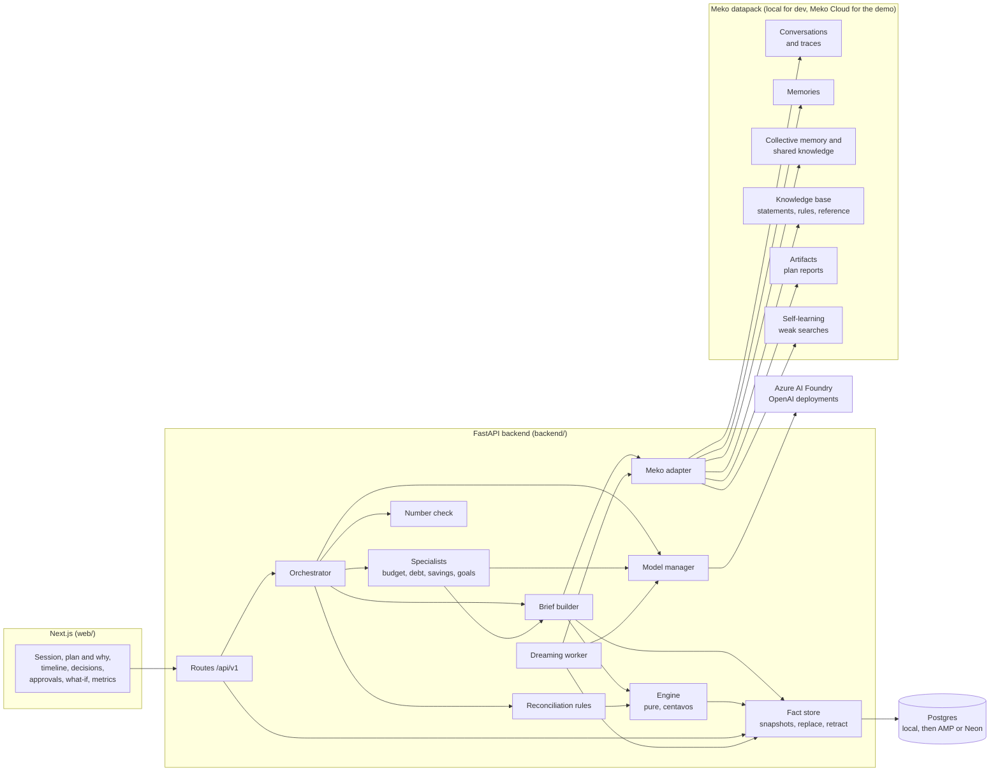

# Architecture

How Kako is built: the parts, how one planning turn and one life event flow through them, how Kako uses
each part of Meko, the controls that keep numbers and memory honest, where it runs and what it costs.
**Code follows this document.** If code and this document disagree, raise it, and update this document
in the same change once agreed.

Tables and formulas are in [data-model.md](data-model.md). The order of work is in
[build-plan.md](build-plan.md). Meko facts here were checked on Nov 17, 2026 against local Meko
1.20261116.0 (its MCP tools, by calling them) and Meko's agent skills plugin v2.6.1 (its tool
references); limits change, so check again before relying on one.

## In one paragraph

Kako is a **Next.js** web app in front of a **FastAPI** backend. The household talks to Kako in
planning sessions; each session is a **Meko conversation**, so every turn and every Meko call is traced.
The household's structured data lives in **Postgres** as facts with a validity window and a replacement
chain, and a **deterministic engine** computes every peso, month and date from a snapshot of those
facts. An **orchestrator** agent answers each turn by calling four **specialists** (budget, debt,
savings, goals) as tools; they read the engine's figures and a context brief built from Meko's memory,
knowledge base and past conversations, and propose moves. Code checks the proposals against the surplus
and against each other; the orchestrator tries other splits through the engine and resolves conflicts in
the open, every agent step is logged for the screen, and a **number check** blocks any figure the engine
did not produce. Models are **Azure AI Foundry** deployments, reached only through the model manager. After each session a **dreaming** job reviews the conversation and the
memories Meko extracted from it, reconciles what it heard with what is known, marks what has been replaced, spots patterns, and puts
proposals in front of the household. Approved facts become Meko memories; approved preferences and
decisions can be promoted to the datapack's **shared knowledge**, where every specialist finds them.

## Diagram

## How one planning turn flows

1. **The household writes** in the session screen. The API appends the turn to the session's Meko
   conversation when the answer is ready (step 8), with a stable seed so a retry stores it once.
2. **Snapshot and figures.** The fact store builds the snapshot for the household's date. If its hash
   differs from the last calculation run, the engine computes a new run; otherwise the last run is
   reused. The engine is pure: same snapshot in, same figures out.
3. **The brief.** Code builds a context brief within a size budget (about 3,000 tokens): the key
   figures, the active decisions with their reasons, approved preferences and constraints, pending
   proposals, and the results of **one** `context_search` on the household's message (memories, shared
   knowledge and documents, past conversations). Specialists start from this brief instead of searching
   on their own, which keeps the answer grounded and the Meko call count low. Agents see stable refs, never
   database ids (`debt:credit-card`, `figure:debt.payoff_months@debt:credit-card`, `M1` for a
   memory), so a recorded turn replays anywhere. Approved preferences come from the fact store, with
   who approved them and when, and are marked promoted once Meko holds them as collective memory.
   Over budget, code drops what agents can fetch again: Meko results (lowest ranked first), the
   rejected options of decisions, older pending proposals, then the facts list.
4. **The orchestrator** reads the brief and calls the specialists it needs as tools, in parallel. It can
   also propose a fact or a life event the household just stated (see the next section).
5. **Each specialist** is a short, bounded loop (at most 4 tool calls) over read-only tools:
   `get_figures`, `get_facts`, `get_decisions`, `search_memory` (one extra Meko search at most) and
   `run_what_if` (the engine with hypothetical allocations). It returns a structured proposal: the
   allocation it wants (an entity and an amount), its recommendation text, and the sources it cites.
   **Amounts are specs, never numbers a model worked out:** `none`, `rest` (the rest of the surplus,
   subtracted in code), `figure:<ref>`, `fact:<ref>`, or `said:<amount>`, an amount the household wrote
   in this turn's message, which code finds there. A proposal rests on one of the specialist's own
   what-ifs, so its allocations are ones the engine has run; code refuses a what-if over the surplus or
   outside the specialist's area, and a proposal that cites no figure of its what-if or no other source
   (V-11). The orchestrator's options are checked the same way: each is one what-if of the turn, cited.
   What-ifs are named after the agent that ran them (`debt1-W1`), and a specialist sees only its own
   what-ifs and searches (the orchestrator sees all of them), so parallel specialists send the same
   requests on every run and a recorded turn replays. A final tool runs only on its own in a reply, so
   an answer rests on results the agent has read.
   Every tool call by every agent is logged as an `agent_step` (the agent, the tool, a short input and
   result, the what-if run if any), which the "agents' steps" view shows.
6. **Reconciliation in code.** Once two or more specialists propose a move, the engine runs once more
   with all their allocations together (each entity takes its own specialist's amount: the debt
   specialist's for a debt, savings' for an account, goals' for a goal). Rules
   (`planning/reconcile.py`) find over-allocation (together the asks leave less than ₱0 of the
   surplus), opposite moves (one raises an allocation another lowers), and goals that miss their date.
   The asks together become a what-if of the turn (`rec-W1`), and code tells the orchestrator what it
   found, with the figures, in a note between its rounds of tool calls. **The what-if loop:** while a
   conflict is open, each `run_what_if` the orchestrator makes is a split, at most 3 a turn; only the
   reconciliation rules can say a split fits, and each split is an `agent_step` (`rejected` when the
   rules refuse it). The answer then carries the resolution: a split that fits, offered as an option
   and recommended, with the what-if it rejected and why; or, when nothing (a preference, a decision,
   the household's own words) supports one split or no split fits, the choice left to the household,
   which sees the conflict and the options, not a guess. The resolution, each split tried and the
   option rejected are shown, and stored in `reconciliation` with the plan.
7. **The number check.** Every number in the reply, the options' labels and summaries, the resolution's
   reason and each specialist's summary must match a figure of the turn's run or one of its what-ifs,
   a fact in the snapshot, a what-if's allocation, or a number the household wrote (rule V-10,
   `agents/numbers.py`). A specialist's summary may also name the turn's own refs, which the
   orchestrator resolves from the proposal's citations; the reply, the options and the reason may
   not. It runs inside the final tools (`submit_answer`, `submit_proposal`): a
   failure is sent back once with the mismatch named; if it fails again, the text is shown with the
   unmatched numbers flagged, never silently. Every check is a `number_check` row, against the turn's
   run, which is stored before the agents start.
8. **Recorded.** Each what-if is kept as it runs: a `scenario`, its `plan.allocation` overrides and
   its run, which its `agent_step` names. A turn that offers options or finds a conflict proposes a
   plan (`db/plan_store.py`, one transaction): the reply is its summary, each option's allocations are
   its recommendations with the option's sources (a figure of the run that showed it, and a fact,
   decision, memory, document or the household's words), and each conflict is a `reconciliation` row.
   Each final number check names the row it checked. The reply goes to the household with a "why" link
   on each recommendation. The turn goes to Meko with a `plan` (the steps taken: the brief, the
   specialists asked, the reconciliation, the options) and `reasoning` (the specialists' summaries and
   the resolution's reason), built by code from what the agents handed in, and metadata naming the
   plan, run, recommendation, reconciliation and what-if run ids, so the Meko trace and Kako's own
   sources say the same thing. The session's Meko calls are its trace: spans in Meko Cloud's Observe
   hub, or local Meko's call log (`GET /api/v1/sessions/{id}/trace`). The plan is `proposed` until the
   household accepts one option; accepting writes its `plan.allocation` facts (Phase 4).

## How a life event replans

This is the centre of the live demo.

1. Mara says she has a new job from Dec 1 at ₱68,000 take-home. The orchestrator calls
   `propose_life_event` and `propose_fact_change`; the backend creates **pending proposals** with the
   quoted words as evidence, and the session shows an approval card at once. (Dreaming would find the
   same thing after the session; proposals have an idempotency key, so it can't be proposed twice.)
2. The household approves. The fact store inserts the new fact, closes the old one (`valid_to` = Dec 1,
   `status` = `replaced`, `replaced_by` = the new one) and records the life event. The Meko adapter adds
   the new memory and rewrites the old one in the past tense.
3. The fact store lists what the event touches: the facts it changed, the calculation inputs that read
   them, and the **decisions whose assumptions** included a replaced fact ("to revisit").
4. The engine computes a new run. The orchestrator asks every specialist whose figures moved to reassess,
   with the decisions to revisit and the preferences in the brief.
5. Kako answers in three parts: **the new plan**; **what changed** (the diff between the last accepted
   plan's run and the new run, each change labelled replaced, retracted, new or allocation, rule
   F-DIFF-1); and **why**, citing the facts, the promoted preference, the earlier decision and the
   session it came from. The plan report is kept as a Meko artifact.

## How dreaming works

A background job queued when a session ends (`dream_run`, one per session, so a rerun does nothing).

1. **Read** the session's turns from Meko (`conversation_get`), the memories Meko extracted from those
   turns on its own (Meko Cloud runs extraction automatically; their `source` is `extract`), Meko's own
   Learnings (its top 5 candidates for sharing), the snapshot, the active decisions and the pending
   proposals.
2. **Extract** candidate claims with the model, as structured output: the entity, the attribute, the
   value **as quoted**, when it takes effect, the quote, and who said it. The model copies; it does not
   calculate. Meko's extracted memories are matched to these claims, so one fact yields one proposal.
3. **Check in code.** Every number in a candidate must appear in its quote (V-09). The candidate is
   matched to an entity and attribute in the catalog, and compared with the snapshot: **same** (dropped),
   **new**, **replace** (a later value for the same thing), **retract** (the household said an earlier
   value was wrong) or **conflict** (two values for the same day; asked as a question).
4. **Patterns.** Code counts the household's decisions by the tags of the option they chose (such as
   `favours_flexibility`, from a fixed list in `decision_option.tags`; the orchestrator tags options when
   it proposes them, and code rejects a tag that is not on the list). Three choices the same way across at least two sessions, with none the other
   way, produce a `preference_pattern` proposal, citing each decision and session.
5. **Promotion candidates.** An approved preference or decision that has held for two sessions is
   proposed for promotion, with the plain warning that promotion can't be undone. A preference goes to
   **collective memory** (a short fact every agent retrieves). A decision goes to **shared knowledge** as
   a decision-record document: the question, the option chosen, the options rejected with their reasons,
   and the assumptions.
6. **Propose.** Everything lands in the approvals inbox with an explanation and its evidence. Nothing
   becomes household knowledge until a person says yes.
7. **On approval**, the fact store writes the rows and the Meko adapter brings Meko in line: add the new
   memory (or link Meko's extracted one), rewrite a replaced one, delete a retracted one, promote what was
   approved for sharing. **On rejection**, an extracted memory the household says is wrong is deleted, so
   no agent finds it again. Every extracted memory ends either linked to a fact or deleted.

Dreaming is a fixed workflow with one model step (extraction); the orchestrator and specialists are the
agentic part. The docs and the video say so.

Dreaming is tested against a labelled set: scripted sessions with the facts, replacements and patterns
a person would expect, scored for what it found, missed and wrongly proposed.

## How Kako uses each part of Meko

| Meko part | Kako's use | Where it shows |
| --- | --- | --- |
| Conversations | One per planning session, turns stored with `plan` and `reasoning` | Session history; dreaming's input |
| Decision traces | The conversation id is the trace id; every Meko call in the session is a span under it | "Open trace" on each recommendation (Meko Cloud's Observe for the demo) |
| Memory | One sentence per approved fact, decision and preference, with Kako's ids in its metadata; replaced facts rewritten in the past tense. Sentences name people and things in full ("Mara Villanueva's take-home pay…"), because Meko's search boosts named entities. Meko's own extracted memories are candidates for dreaming | Specialists' context; the timeline |
| Learning (promotion) | Dreaming reads Meko's Learnings and extracted memories, proposes, the household approves; a preference is promoted to collective memory, a decision record to shared knowledge | "Learned on Oct 18 from the October session" in the why panel |
| Knowledge base | Synthetic statements (CSV), planning rules and Philippine reference documents (Markdown) | Cited excerpts in the why panel |
| Artifacts | Each plan report | Download on the plan screen |
| Postgres in the datapack (AMP) | The household's structured data, if the Phase 1 test passes; a scenario kept as an AMP branch (Should) | Architecture slide; what-if screen |
| Self-learning (Context Gaps) | A **Must** if the Phase 1 test finds the tools on our account. `selflearning_shortfalls` lists `context_search` queries that came back Mid or Low (best score under 0.75); Kako asks the household; the answer goes through a proposal; `selflearning_verify` replays the search and reports `improved`. Kako's brief uses `context_search`, which is the only search the log counts. Each replay counts as one search, so it goes through the call counter | "Kako would like to know" card; before and after scores on the metrics page |
| Metrics | `datapack_metrics` (context size, efficiency, relevance) next to Kako's own token and number-check counts | The metrics page |

What Meko does not do, and Kako adds (see [concept.md](concept.md#what-meko-already-does-and-what-kako-adds)):
Meko keeps both "₱100,000" and "₱120,000" as memories and returns both (tested); Kako decides which is
current, what it replaced and which plans and decisions depended on it.

## Components

| Component | Where | What it does |
| --- | --- | --- |
| Web app | `web/` | Next.js App Router, TypeScript strict, Tailwind and shadcn/ui. Rewrites `/api/v1/*` to the backend. Never sees database rows, only response schemas |
| API | `backend/src/kako/api/` | FastAPI routes under `/api/v1`: sessions and turns (built: `POST /sessions`, `GET /sessions/{id}`, `POST /sessions/{id}/turns`, `GET /sessions/{id}/trace`; one turn at a time), plans, why, diff, facts timeline, decisions, proposals and approvals, what-ifs, metrics |
| Engine | `backend/src/kako/engine/` | Pure functions from a snapshot (and optional hypothetical allocations or overrides) to figures, each citing the facts and figures it read, and the diff between two runs (F-DIFF-1, with the decisions to revisit). No database, network, clock or randomness; `tests/test_purity.py` enforces it |
| Fact store | `backend/src/kako/facts/` (pure rules) and `backend/src/kako/db/fact_store.py` (the writes) | The attribute catalog, snapshots (`on`, `known_at`), the validation rules, replace and retract, what an event touches |
| Planning | `backend/src/kako/planning/` | Plans, recommendations and sources, reconciliation rules (`reconcile.py`, pure like the engine), diff, what-ifs |
| Decisions | `backend/src/kako/decisions/` | Decision records, options, assumptions, "to revisit" |
| Agents | `backend/src/kako/agents/` | `model_manager.py` (the only module that imports a model SDK: the OpenAI SDK against Azure AI Foundry, signed in with Entra ID), the tool loop with its bounds and the step log, recorded responses, orchestrator, the four specialists, brief builder, tools, number check, prompts |
| Dreaming | `backend/src/kako/dreaming/` | The job, extraction, classification, patterns, proposals |
| Meko adapter | `backend/src/kako/meko/` | One interface for every Meko call, an MCP client implementation, an in-memory fake for unit tests, the call counter and quota guard |
| Database | `backend/src/kako/db/` | SQLAlchemy 2 async models, repositories, Alembic migrations |
| Settings | `backend/src/kako/settings.py` | `pydantic-settings`: database URL, Meko URL and key, the Foundry endpoint, deployment names and their prices, budgets, demo mode |
| Demo data | `data/demo-household/`, `backend/src/kako/demo/` | The synthetic household as files (the seed, the approved changes, statements, documents; session scripts later), read and checked by `demo/files.py` and loaded through the fact store by `demo/load.py` (`kako demo load`) |

The backend is organised by domain, with `core → domain → infrastructure`: the engine and fact rules
never import the database, Meko or the model SDK.

## Agents

| Agent | Job | Tools | Writes |
| --- | --- | --- | --- |
| Orchestrator | Reads the brief, decides which specialists to ask, resolves conflicts, writes the answer, proposes facts and events the household stated | The four specialists, `get_figures`, `get_facts`, `get_decisions`, `propose_fact_change`, `propose_life_event`, `propose_decision` | Pending proposals only |
| Budget | Spending against income; where the surplus comes from | Read tools, `run_what_if` | Nothing |
| Debt | Payoff order and extra payments, respecting preferences | Read tools, `run_what_if` | Nothing |
| Savings | Emergency runway and target | Read tools, `run_what_if` | Nothing |
| Goals | Goal dates, required contributions, trade-offs | Read tools, `run_what_if` | Nothing |
| Dreaming | Extracts claims from a finished session | None (structured output only) | Pending proposals, through code |

Bounds: at most 4 specialist calls per turn, at most 4 tool calls per specialist, one extra Meko search
per specialist, at most 3 what-if splits per conflict, a token budget per turn, and a daily spend cap in
settings. Deployment names live in settings only; the orchestrator and dreaming use the stronger
deployment and the specialists a faster one, confirmed in Phase 3 by the agent test set.

**Why four specialists and not one agent.** Each specialist gets its own role and scope on the shared
brief, its own rules from the knowledge base and its own what-ifs. Phase 3 runs the agent test set once against a
single all-in-one agent as a baseline; both scores go on the metrics page. If the specialists don't
score better, the docs say so and the design is revisited.

**Prompts and context.** Every agent's system prompt starts with the same two parts, the shared rules
and the turn's brief, so the provider's prompt cache serves them to every agent of the turn; each
specialist's slice is its role and scope, which come last (`backend/src/kako/agents/prompts/`). Each
prompt is short and sectioned: the role, the one rule (the engine
calculates, agents explain and propose, the household decides), a glossary of figure keys, the tool
contract and one worked example. Stable parts come first so prompt caching applies. Conversation text,
memories and documents are wrapped as data, never as instructions.

## Where data lives

| | Development and tests | Demo |
| --- | --- | --- |
| Meko | Local Meko (`MEKO_MCP_URL=http://127.0.0.1:7777/mcp`); in CI, the same release installed from GitHub | Meko Cloud, one datapack for the demo household |
| Postgres | Local Postgres in cloud sessions and a CI service, a fresh database per test run | AMP in the demo datapack if the Phase 1 test passes; otherwise a free managed Postgres (Neon) |
| Model | Azure AI Foundry deployments with a small dev budget; unit tests use a recorded fake | Azure AI Foundry |
| Backend and web | Cloud sessions and CI | The laptop, natively on Windows (`uvicorn` and `next dev`, no Docker or WSL): the video is recorded locally against Meko Cloud, cloud Postgres and Foundry. No hosted app (Pim, Nov 17) |

**Demo mode** (for judges, Pim, Nov 17). One command starts Kako against local Meko and a local
database with the demo household, and the model manager replays **recorded model responses** instead of
calling Foundry, so no Azure account is needed. It replays the scripted sessions only; asking new
questions needs live mode with a Foundry deployment. The README says both plainly and gives setup steps
for each.

**Recorded responses** (`agents/recorded.py`). A recording is a JSON file of model replies, each under
the key of the call it answered: `<turn seed>/<agent path>/<n>`, such as `session-2:turn-1/debt#1/2`.
Keys, not request hashes, so a turn replays in the same order on any machine, whatever ids its local
database and local Meko gave things; each call also keeps its request's SHA-256, and a strict replay
(the default) refuses a reply whose prompt has changed since it was recorded. `KAKO_MODEL_MODE` picks
`live`, `record` (live, saving each reply; it costs money, so it needs Pim's yes first) or `replay`
(no network, no Azure settings). Tests use a scripted model instead and never call Foundry.

**AMP constraints** (from Meko's AMP reference): a database is reached from outside Meko only through
an `ingress_external` endpoint with an allow-list of `/32` source addresses chosen at create time, so the
laptop's public IP goes on the allow-list (and is checked again before recording); creating a branch or compute can block for up to 5 minutes; only the
datapack owner can create them; compute counts against a per-account vCPU cap. So what-ifs run in the
engine in memory, always, and keeping one as an AMP branch is an optional step done ahead of time, never
on the click path. The Phase 1 test (docs/meko-setup.md) measured the Free cap at 0.5 vCPU for the whole
account: the main database's writer uses all of it, so a branch can be created (in under 3 seconds) but
not queried. A kept scenario branch is a record, not a second database.

## Controls

| Control | How |
| --- | --- |
| No numbers from a model | The engine computes; agents read figures; the number check (V-10) blocks the rest; dreaming copies quoted numbers only (V-09) |
| No silent overwrite | Facts are insert-only apart from the status transitions in the data model; a database trigger rejects other updates and deletes |
| A person decides | Every fact, event, decision, preference and promotion starts as a proposal; promotion asks twice because it can't be undone |
| Traceable advice | Every recommendation has a figure source and a non-figure source (V-11), and its Meko turn |
| Prompt injection | Session text, memories and documents are passed as data; agents have read tools and `propose_*` tools only; nothing an agent says can write without approval |
| Spend and quota | Token budget per turn (`KAKO_TURN_TOKEN_BUDGET`) and a daily cap (`KAKO_DAILY_SPEND_CAP_USD`), both checked in the model manager before each call, with at most `KAKO_MODEL_MAX_RETRIES` retries and every attempt in `llm_call`; an Azure budget with email alerts on Kako's own resource group; a Meko call counter with a ceiling per environment, so rehearsals can't use up the Free tier's lifetime allowances |
| Meko's own extraction | Meko Cloud extracts memories from the household's words before anyone approves them. Dreaming treats them as candidates; each ends linked to an approved fact or deleted. A Phase 1 test checks whether extraction can be turned off on a Cloud datapack (local Meko allows it) |
| Not financial advice | Synthetic household only; the app and README say so; no product picks, no tax calculations |
| Secrets | Environment variables only; `.env` is gitignored and `.env.example` lists the names |

## Cost plan

| Item | Plan | Recurring cost |
| --- | --- | --- |
| Meko | Free tier; local Meko for development | None. The lifetime allowances below are the real limit |
| Postgres | Local; AMP (Free) or Neon (free) for the demo | None expected |
| Azure AI Foundry | Pay-per-token deployments (Standard or Global Standard, never Provisioned), in Kako's own resource group with a monthly budget and alerts; signed in with Entra ID, no keys; per-turn budget and daily cap; tests and demo mode use recorded responses | Usage only. The budget is set before Phase 3; cost per turn is on the metrics page |
| Hosting | None: the demo runs on the laptop for the video | None |
| CI | GitHub Actions on a public repository | None |

**Meko Free-tier lifetime allowances** (account-wide, from Meko's tool reference, Nov 2026): 1,000
each of `memory_search`, `knowledgebase_search`, `context_search` and `conversation_add_message`; 10,000
`memory_add`; 1,000 conversations. A demo session of about 8 turns uses about 8 conversation turns, 8
to 16 searches and a few memory writes, so seeding sessions 1 to 3 once and rehearsing session 4 about
ten times stays well under every limit. The call counter enforces it.

## Production path (documented, not built)

Per-person privacy (each adult's private memories, shared household knowledge) needs Meko's shared
datapacks and roles, which are Pro only. Real households would also need bank-statement import with
consent, encryption of personal data at rest, and deletion on request. None of this is in the MVP.
